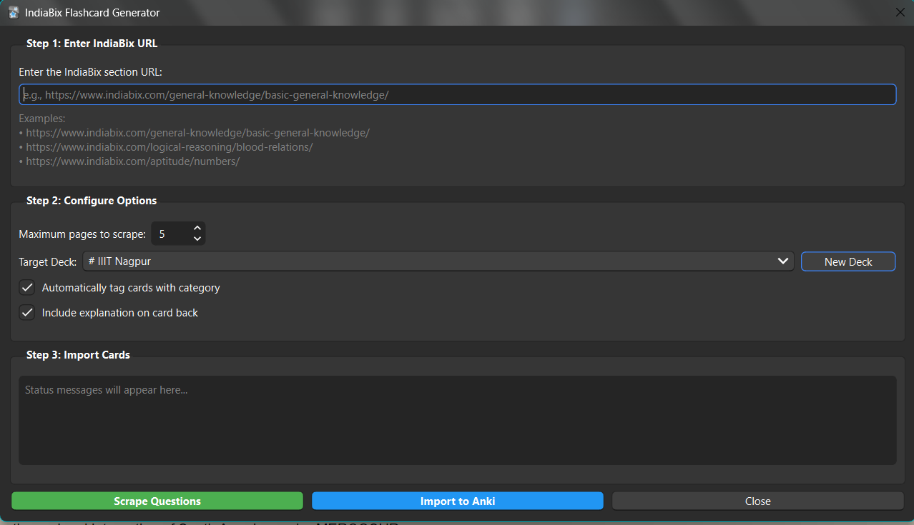

# IndiaBix Flashcard Generator

An Anki add-on that scrapes IndiaBix question banks (General Knowledge, Aptitude, Reasoning and more) and turns them into formatted MCQ flashcards. It can also auto-sync daily Current Affairs into Year, Month and Week subdecks. Listed on AnkiWeb with add-on code `1588987238`.

## Guides
- [Installation](INSTALL.md)
- [Quick start](QUICKSTART.md)
- [Architecture](ARCHITECTURE.md)
- [Current Affairs auto-sync](CURRENT_AFFAIRS_FEATURE.md)
- [Demo](DEMO.md)
- [Deployment](DEPLOYMENT.md)

## Links
- [Source and README](https://github.com/The-Harsh-Vardhan/AnkiBix-Extension)
- [AnkiWeb page](https://ankiweb.net/shared/info/1588987238)
- [Changelog](https://github.com/The-Harsh-Vardhan/AnkiBix-Extension/blob/master/CHANGELOG.md)
